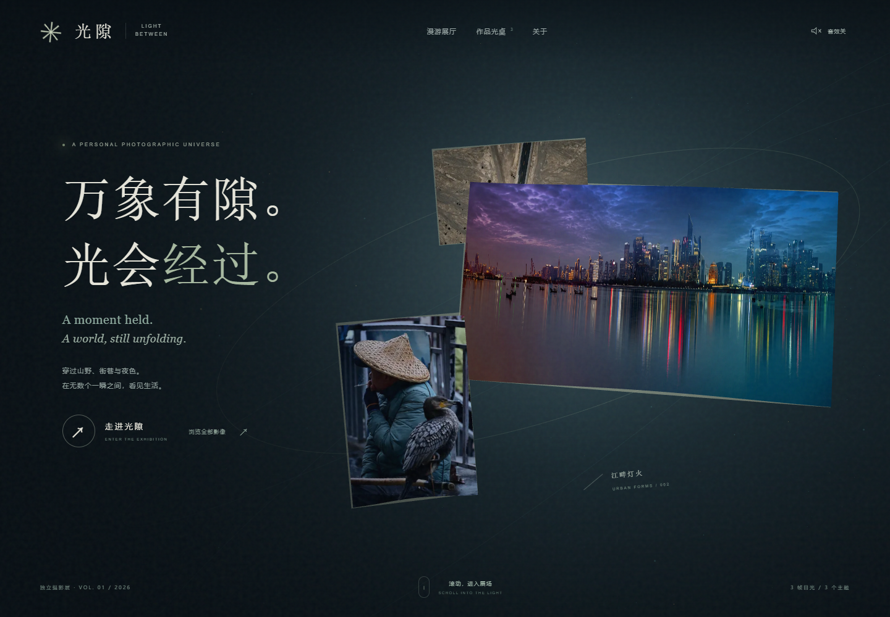

# 光隙 · LIGHT BETWEEN

一个把摄影作品放进三维空间的展览程序。滚动进入展厅，在照片之间漫游，也可以切换影像星图或按主题浏览光桌。

A photographic exhibition with a continuous 3D scene, a rotating image atlas and a searchable contact sheet.

[打开公开演示 / Open demo](https://garry-tang-274.github.io/light-between-gallery/)



## 先运行

需要 Node.js 20.19+ 或 22.12+。在项目目录运行：

```sh
npm ci
npm run dev
```

打开终端显示的网址。`npm run build` 生成 `docs/`，可直接部署到 GitHub Pages 的 main /docs；资源采用相对基础路径，也可部署到其他静态网站。

The demo includes three photographs already published in the author's public portfolio. The separate personal exhibition and its full collection are not included in this repository.

演示只附带三张已经公开过的作品；独立个人展览及完整私人相册不在这个源码包内。

## 可以做什么

- 序厅、环形漫游和影像星图在同一三维场景内切换。
- 拖动、滚动、方向键与位置滑杆控制观看；点击照片看大图。
- 主题筛选、标题/文件名搜索、排序、缩略图导航、放大、全屏与自动播放。
- 音效默认关闭，没有背景音乐；尊重系统减少动态效果设置。
- WebGL 不可用时，可使用作品光桌继续查看照片。

Three.js handles the scene, GSAP handles transitions, and Vite builds the static site. There is no account system, upload endpoint or analytics service. Dependency installation uses the package registry; the built exhibition uses its bundled runtime and local demo photos.

## 换成自己的作品

1. 将 `tools/curation.example.json` 复制为 `tools/curation.json`，填写你有权展示的照片路径、唯一 ID、标题和分类。自己的清单默认被 Git 忽略。
2. 安装 Python 与 Pillow，运行 `python tools/prepare_photos.py`。
3. 查看 `public/photos.json` 与生成副本，确认只含你打算公开的照片，再运行 `npm run build`。

分类使用 `wild`、`street`、`city`、`night`、`nature`。沿用示例中的 `p001`、`p002`、`p005` ID 更换作品，可以保留序厅构图；其他 ID 的序厅位置由 `src/world.js` 中的 `homePoses`、`mobileHome` 配置。标题、首页注记与关于页图片也应同步修改。全部作品仍可在漫游、星图和光桌中浏览。

预处理只生成 360px、720px 与最长边 2560px 的 WebP 副本，不改原图、不重新调色、不携带原始 EXIF/GPS。清单中 `include=false` 的条目不生成。图像路径须可由本机读取；网页不会扫描你的文件夹。

标题和描述由你填写，不从文件名猜测拍摄地点。`public/photos.json` 会显示文件名；公开前也应检查文件名是否包含私人信息。替换同 ID、删除或排除旧照片时，先移走 `public/photos/` 中对应的旧生成副本，再重新预处理和构建。

Rebuild the bundled public demo from its original public sources with:

```sh
python tools/download_demo.py
python tools/prepare_photos.py --manifest tools/curation.example.json
npm run build
```

## 发布前检查

```sh
node --check src/main.js
node --check src/world.js
npm run build
```

然后检查序厅、漫游、星图、主题、搜索空结果恢复及大图。样本数量变化时，界面从清单读取数量，只显示实际有作品的分类。

## 许可

程序代码使用 [MIT License](LICENSE)。示例照片 © Zhi Tang，保留全部权利，不随代码授予再分发或商业使用许可；复用展览请换成自己的照片。依赖条款见 [THIRD_PARTY_NOTICES.md](THIRD_PARTY_NOTICES.md)。
